# the last dataset - competition writeup

**team:** TECHTEAM10129 (team 10129)  
**category:** COGNITIA // PRALAYA  
**leader:** KRISHNENDU (delegate id: 10560)  
**current score:** 700 PTS  
**zones cleared:** Sanctuary Gate, Yellow Zone (Community), Blue Zone (Radio Comms), Red Zone (Metropolis & Bioarchive Core)  
**datasets unlocked:** `community_final.csv`, `radio_final.csv`, `CHILD_FINAL.csv`, `PARENT_FINAL.csv`  

---

## table of contents
1. [sanctuary prologue & gate ctf](#1-sanctuary-prologue--gate-ctf)
2. [yellow zone (community)](#2-yellow-zone-community)
3. [yellow to blue transition](#3-yellow-to-blue-transition)
4. [blue zone (radio communication sector)](#4-blue-zone-radio-communication-sector)
   - [ctf 01: intercepted message](#ctf-01-intercepted-message)
   - [ctf 02: compromised node](#ctf-02-compromised-node)
   - [ctf 03: recovered transmission](#ctf-03-recovered-transmission)
   - [ctf 04: intercepted carrier & geoint](#ctf-04-intercepted-carrier--geoint)
   - [station 05: emergency broadcast console & final override](#station-05-emergency-broadcast-console--final-override)
5. [evidence board inventory & reconstruction graph](#5-evidence-board-inventory--reconstruction-graph)
6. [red zone (metropolis & bioarchive core)](#6-red-zone-metropolis--bioarchive-core)
   - [6.1 3d metropolis hub & sector entry](#61-3d-metropolis-hub--sector-entry)
   - [6.2 ctf 01: ghost signal (relay station 01)](#62-ctf-01-ghost-signal-relay-station-01)
   - [6.3 ctf 02: sanctuary archive (the silent edit)](#63-ctf-02-sanctuary-archive-the-silent-edit)
   - [6.4 ctf 03: child dataset (metadata forensics)](#64-ctf-03-child-dataset-metadata-forensics)
   - [6.5 ctf 04: central atrium (deadlock engine)](#65-ctf-04-central-atrium-deadlock-engine)
   - [6.6 red zone completion & parent dataset recovery](#66-red-zone-completion--parent-dataset-recovery)

---

## 1. sanctuary prologue & gate ctf

logged into the main tactical map at `last-dataset.vercel.app` using our team credentials (`TECHTEAM10129`). all quarantine sectors started locked with yellow zone requiring us to complete the sanctuary storyline briefing first.

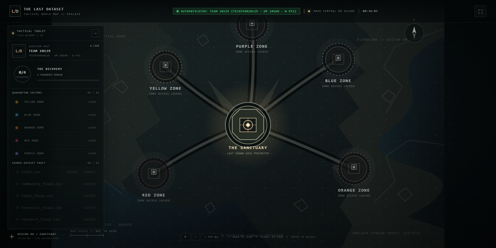

clicked on sanctuary on the map which loaded the 3d assembly hall at `last-dataset-sanc.vercel.app`.

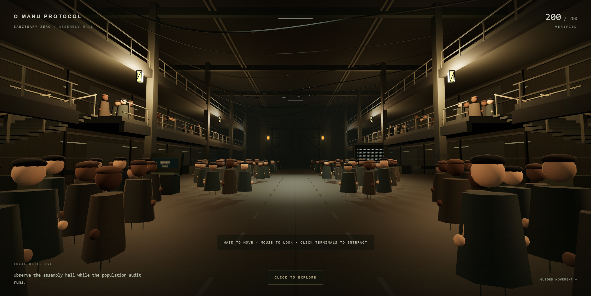

walked over with wasd to station 1 (identity services / resident registry) and pressed e to inspect the terminal.

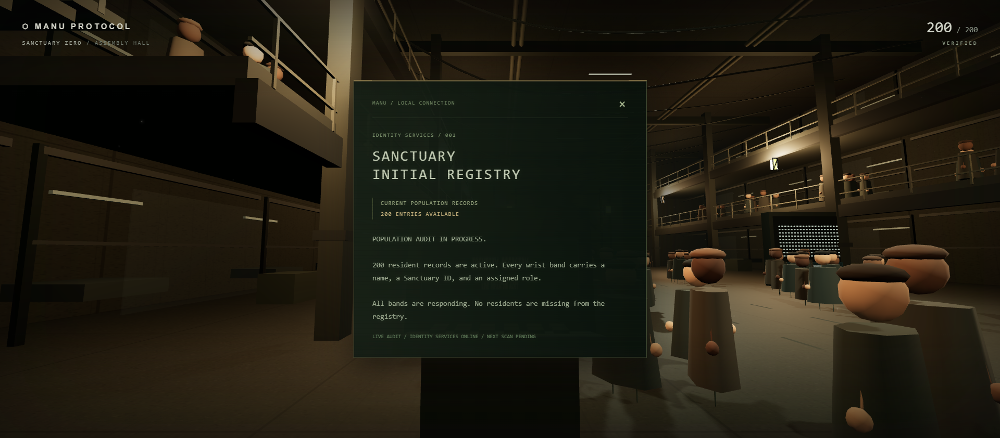

the terminal initiated the population audit scan. 200 resident records were initially active. after 15 seconds, a catastrophic registry corruption event triggered—the population counter desynced rapidly down from 200 to 61 verified residents. 

the terminal dropped an incident log from the final maintenance technician:
```text
“THE SCREEN STILL KNOWS.
THE ORDER IS STILL LIT.”
01 / AUREX
02 / NOCTRA
03 / VELORA
```

we followed the story redirect through the 4 transit slides detailing the infected wave breach. at slide 4 ("THE ONLY WAY OUT"), clicked return to civic access controller.

navigated to the civic access controller terminal near the quarantine gate. the terminal demanded a transfer authorization code with placeholder `MANU{...}`.

remembered the competition rulebook briefing which contained an embedded hint:
> *"Remember, MANU{the_registry_remembers} every fragment recovered from the archive."*

tested `MANU{the_registry_remembers}` in the terminal:

```text
flag: MANU{the_registry_remembers}
```

the terminal flashed:
```text
> TRANSFER AUTHORIZATION ACCEPTED
> CIVIC ACCESS CORRIDOR OPEN
```

this unlocked the yellow zone route directly on the central hub.

---

## 2. yellow zone (community)

entered the yellow zone (`COMMUNITY // YELLOW ZONE`) at `yellow-zone-neon.vercel.app`. 

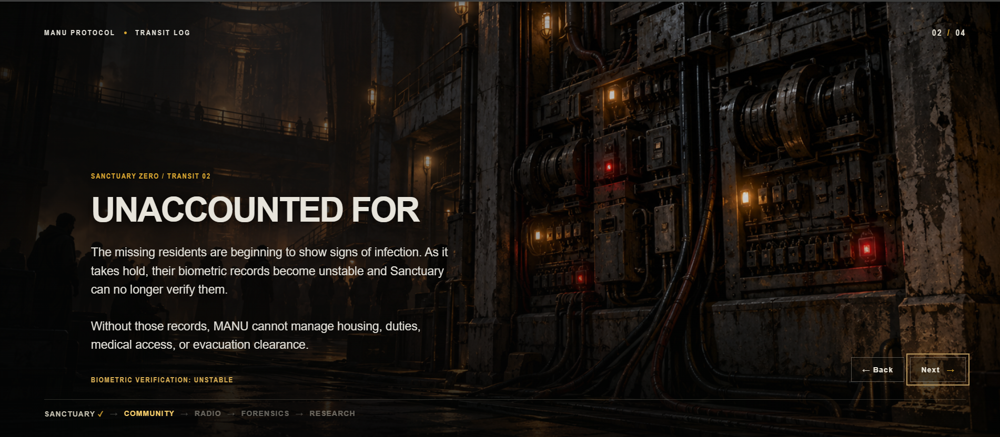

the objective was to reconstruct the unindexed continuity ledger by recovering 5 connected traces across the 5 sector buildings:
$$\text{Hospital (01)} \to \text{School (02)} \to \text{Museum (03)} \to \text{Sports Complex (04)} \to \text{Society (05)}$$

the final signature format at the bottom of the map was:
```text
FLAG{DATASET_ID_CYCLE_EVENT_TIME_SOURCE_NODE}
```

walked through each building in numbered order:

### node 01: hospital (`MED-Y01`)
- entered the entrance room and opened the local account mirror `@afterhours_217`.
- found the trauma triage bay incident report. the digital registry marked patient intake as `EMPTY`, but the physical paper intake and raw relay buffer preserved an anomalous pulse recorded at `02:17:06`.
- normalized to $HHMM$ format:
  $$\text{EVENT\_TIME} = \text{0217}$$

### node 02: school (`EDU-Y02`)
- entered the cognitive development wing and opened `@null.archive`.

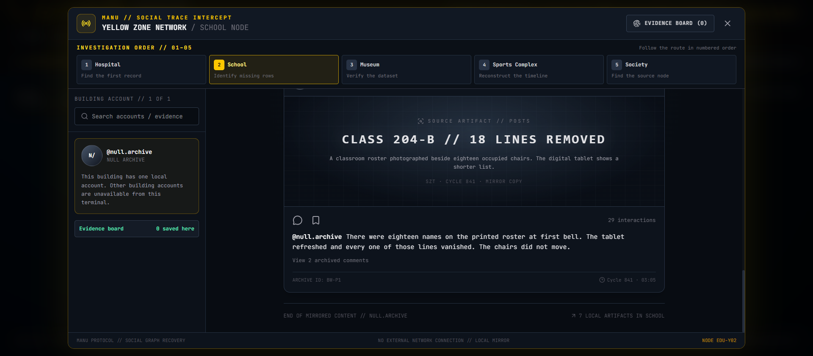
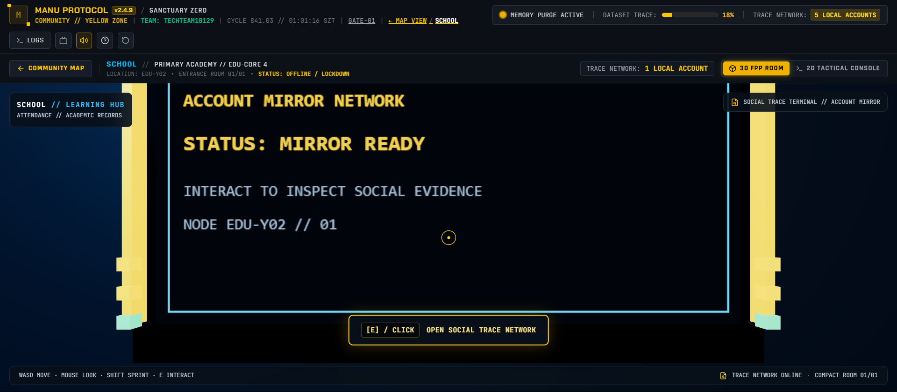

- incident report showed 18 students on the physical roster whose names were wiped from the digital classroom tablet.
- the archivist preserved the export template schema in the notes:
  $$\text{EXPORT FIELDS: DATASET\_ID} \to \text{CYCLE} \to \text{EVENT\_TIME} \to \text{SOURCE\_NODE}$$
- this confirmed the exact concatenation order and that seconds must be dropped from the time.

### node 03: museum (`ARC-Y03`)
- opened the heritage archive terminal `@glassward`.
- compared the updated public exhibition wall label against the preserved conservation card `C-841`.
- the original catalog card explicitly gave the true dataset identity:
  $$\text{DATASET\_ID} = \text{CONTINUITY}$$

### node 04: sports complex (`ATH-Y04`)
- opened the athletic pavilion terminal `@splitlap_841`.
- the official public stream replay had been delayed to 02:19, but the sub-level electrical routing buffer preserved the raw unedited timing pulse:
  $$\text{CYCLE} = \text{841}$$

### node 05: society (`RES-Y05`)
- opened the residential living area terminal `@unit404.window`.
- compared the physical doorway plates in Theta Block against the digital housing index. unit 404 was filtered out of the central database but physically existed:
  $$\text{SOURCE\_NODE} = \text{UNIT404}$$

### assembling the yellow zone recovery key:
assembled all 4 pieces using the school's template:
```text
FLAG{CONTINUITY_841_0217_UNIT404}
```

submitted the key in the bottom-right terminal on the main community grid:

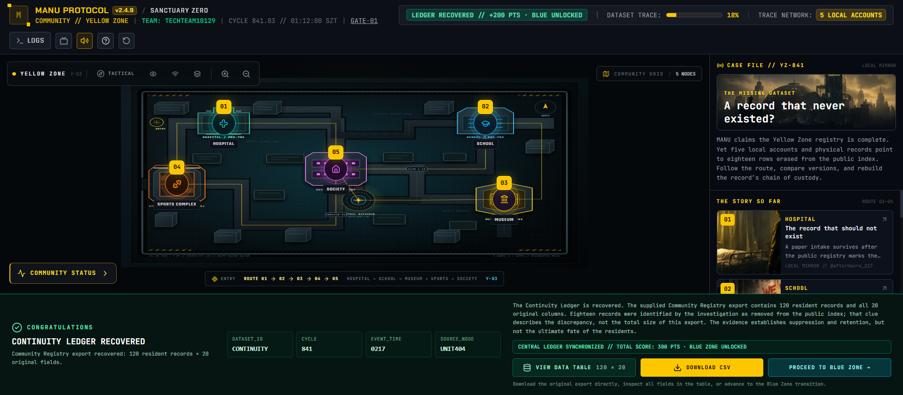

the ledger unlocked:
```text
LEDGER RECOVERED // +200 PTS · BLUE UNLOCKED
```

checked the main tactical map: team score jumped to **300 PTS**, `community_final.csv` (120 rows, 20 columns) was added to our vault for download, and blue zone turned available.

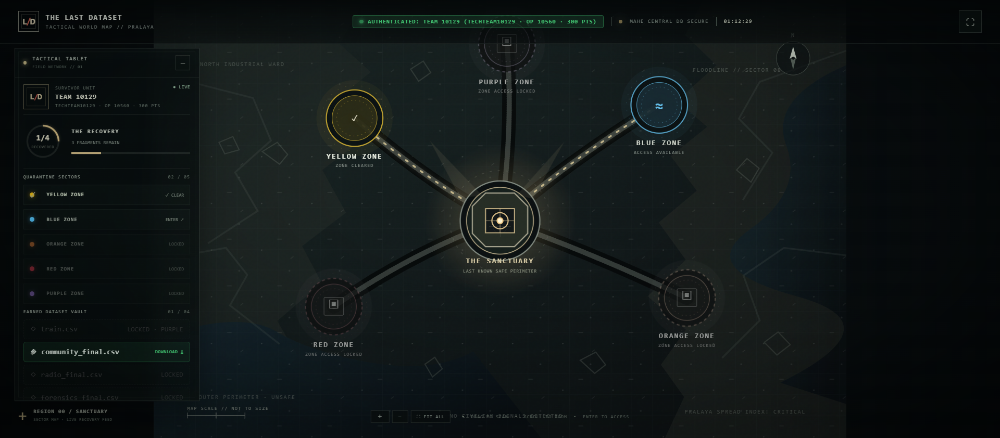

---

## 3. yellow to blue transition

opened the transit slideshow connecting community to radio:

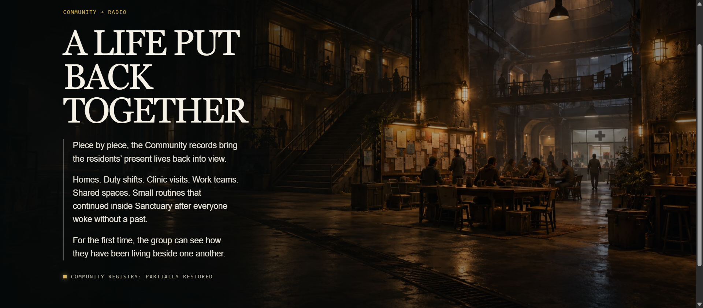

clicked through the 5 transit log slides:
- **slide 1 (a life put back together):** restored community records bring resident routines into focus.
- **slide 2 (the same final entry):** reveals multiple residents simultaneously abandoned their stations with the log: *"Resident responded to citywide emergency alert."*
- **slide 3 (no one remembers the alert):** residents have no memory of hearing or issuing the evacuation alarm.
- **slide 4 (follow the signal):** traces the alert through the old municipal infrastructure to the radio transmission towers.
- **slide 5 (radio communication sector):** links directly to `https://bluezone-xi.vercel.app/blue-zone`.

---

## 4. blue zone (radio communication sector)

entered the blue zone radio sector console.

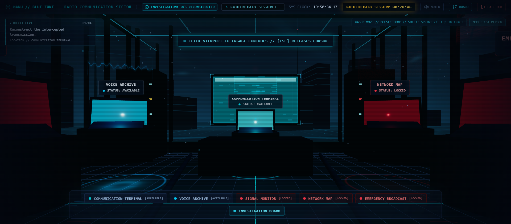

the sector is organized into 4 investigation stations and 1 central emergency broadcast relay.

### ctf 01: intercepted message
- opened **station 01: communication terminal (`RF-COMM-01`)**.

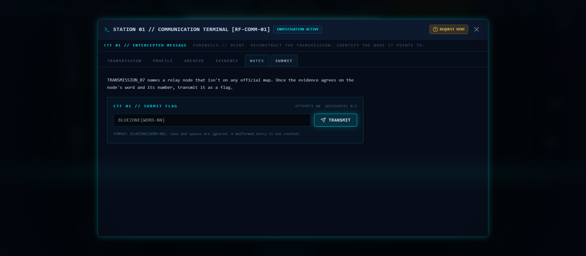

- reviewed the social cache mirror of `@echo_afterfall` (an operator who went dark on Day 214).
- posts referenced the night watch from the rail bridge (`#nightwatch`), the permanent beacon light, and the blackout on Day 214.
- cross-referenced the posts with the relay archive table: tower 17 was logging events under the tag `BLACKOUT`.
- format was `BLUEZONE{WORD-NN}`:
  ```text
  flag: BLUEZONE{BLACKOUT-17}
  ```
- *gotcha note:* make sure to use standard keyboard hyphen `-` (ascii 0x2d), as copying stylized dashes like en-dash `–` causes verification failure.
- submitted in the `SUBMIT` tab $\to$ `> FLAG VERIFIED`, unlocking station 02 (network map) and giving recovered fragment 1.

### ctf 02: compromised node
- opened **station 04: relay network map (`RF-TOPO-04`)**.

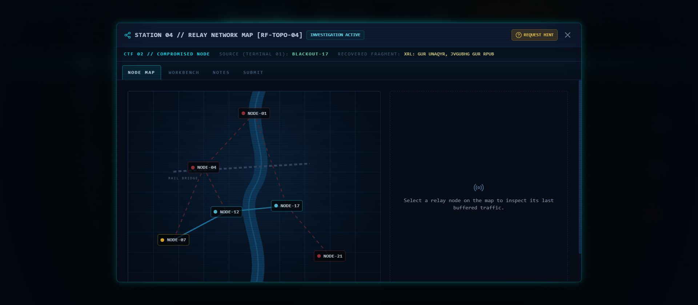

- terminal 01 rewarded us with a recovered fragment:
  ```text
  XRL: GUR UNAQYR, JVGUBHG GUR RPUB
  ```
- popped it into **dcode.fr rot13 decoder**:
  $$\text{ROT13}(\text{XRL: GUR UNAQYR, JVGUBHG GUR RPUB}) \longrightarrow \text{KEY: THE HANDLE, WITHOUT THE ECHO}$$
- the operator handle from ctf 01 was `@echo_afterfall`. removing "echo" left:
  $$\text{KEY} = \text{AFTERFALL}$$
- clicked on **`NODE-17`** (corresponding to tower 17). its buffered packet had armored text:
  ```text
  RUhBUyBLVCBBWUogT1VYVlJZT0MgRFRORVAgQ05TRVBOTkdLLiBLTUUgTVdBSERTTFkgV0xEIE5UIExYRldNLiBFU0UgV1hQUkRTIE9URCBTSFggV0ZJVyAtIEVISlIgQVZXRSBFQ0lVSUlVLiBTRUlGUyBYVFJULTAwMDIgWFRUV0wgV0hZS0pTIEVaIEdGTUlORlkgRExOSC0wMDM0LiBGQyBDRlNFIFdPTEwgVlpJRSBFU0UgS1RNQ0pEIFNMTklMTFJQRSBOU0FTR0lDLiBIT1lRSVdGIFZGWlRQOiBNTFpYREZTRXtEVExKR1hfSUpMTEp9
  ```
- opened **cyberchef / base64 converter** to peel off the transport encoding:
  ```text
  EHAS KT AYJ OUXVRYOC DTNEP CNSEPNNGK. KME MWAHDSLY WLD NT LXFWM. ESE WXPRDS OTD SHX WFIW - EHJR AVWE ECIUIIU. SEIFS XTRT-0002 XTTWL WHYKJS EZ GFMINFY DLNH-0034. FC CFSE WOLL VZIE ESE KTMCJD SLNILLRPE NSASGIC. HOYQIWF VFZTP: MLZXDFSE{DTLJGX_IJLLJ}
  ```
- decoded the vigenère cipher using key `AFTERFALL` on **dcode.fr**:
  ```text
  ECHO TO ANY OPERATOR STILL LISTENING. THE BLACKOUT WAS NO STORM. THE RELAYS DID NOT FAIL - THEY WERE TRIPPED. NEXUS SANC-0002 STILL ROUTES TO GATEWAY SANC-0034. MY LAST LOGS RIDE THE FAILED HANDSHAKE CHANNEL. CONFIRM ROUTE: BLUEZONE{SILENT_RELAY}
  ```
- submitted:
  ```text
  flag: BLUEZONE{SILENT_RELAY}
  ```
- verified $\to$ unlocked station 02 (voice archive).

### ctf 03: recovered transmission
- opened **station 02: voice archive (`RF-VOX-02`)** and inspected audio recording `VA-07`.
- downloaded `va-07.65b9c55b.wav`. under the voice static, heard repeating high-frequency tone bursts.
- uploaded the audio file directly into **morsecode.world audio decoder**:

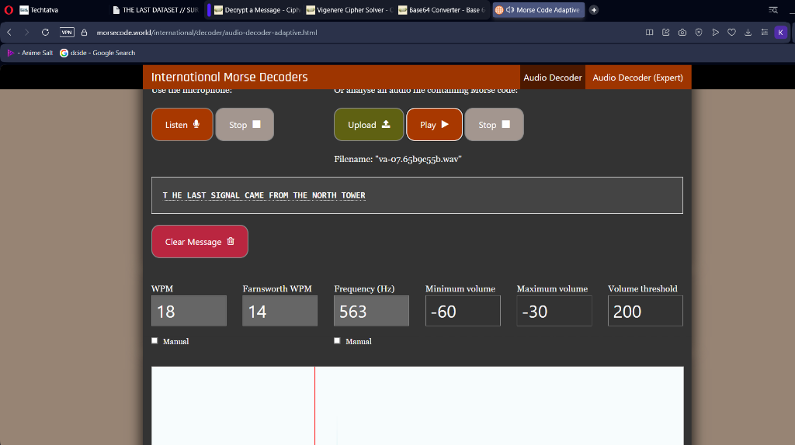

- the adaptive audio decoder transcribed:
  ```text
  T H E  LAST  SIGNAL  CAME  FROM  THE  NORTH  TOWER
  ```
- opened the **`TOWER LOGS`** tab to follow the north tower (`NT-04`).
- operator note specified:
  > *"Only the entries of the tower the recording names should be considered, in the order they were logged."*
- filtered the 10 logged days for north tower (`NT-04`) and matched them to the latched characters in the `VA-07 Channel Buffer`:

| North Tower Log Day | Event | Latched Buffer Char |
| :---: | :--- | :---: |
| Day 203 | SYSTEM CHECK | **N** |
| Day 205 | BEACON TEST | **O** |
| Day 208 | SIGNAL DRIFT | **R** |
| Day 210 | POWER CYCLE | **T** |
| Day 211 | SCHEDULED MAINTENANCE | **H** |
| Day 213 | UNAUTHORIZED ACCESS | **L** |
| Day 215 | CHANNEL RESET | **I** |
| Day 217 | MANUAL OVERRIDE | **G** |
| Day 218 | SYSTEM LOCK | **H** |
| Day 219 | OUTBOUND TRANSMISSION | **T** |

- assembled keyword: `NORTHLIGHT`
- submitted in `SUBMIT` tab:
  ```text
  flag: BLUEZONE{NORTHLIGHT}
  ```
- verified $\to$ unlocked station 03 (signal monitor).

### ctf 04: intercepted carrier & geoint
- opened **station 03: signal monitor (`RF-SPEC-03`)**.

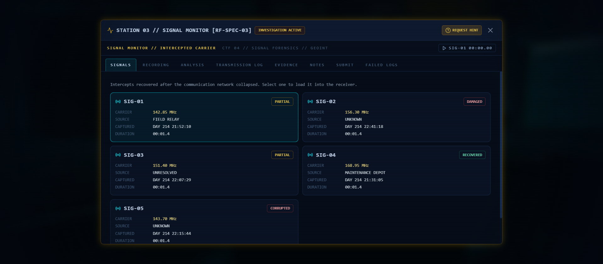

- inspected `TRANSMISSION LOG`: between `SIG-01` to `SIG-05`, only **`SIG-04`** (`168.95 MHz`, Maintenance Depot) received a `COMMAND ACCEPTED // RELAY ACK`.
- loaded `SIG-04` in receiver. the audio contained 6 dual-frequency keypad bursts (DTMF tones).
- decoded the DTMF dual-tone frequencies:
  $$7 - 3 - 1 - 2 - 0 - 4 \implies \mathbf{731204}$$
- opened the **`EVIDENCE`** tab and entered record reference `731204`:

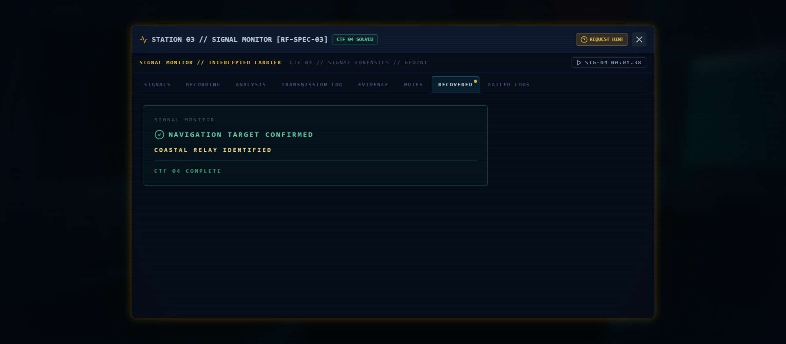

- the retrieved log displayed:
  ```text
  COMMAND: 731204 (STATUS: EXECUTED)
  NAVIGATION DATA: LAT 13.2239132, LON 74.7367936
  REFERENCE: COASTAL RELAY
  FIELD NOTE: “WHEN THE NETWORK GOES DARK, FOLLOW THE LIGHT.”
  ```
- looked up coordinates `13.2239132, 74.7367936` on map: marks **Kapu Lighthouse** (Kaup, Udupi coastline).
- submitted:
  ```text
  flag: BLUEZONE{KAPU_LIGHTHOUSE}
  ```
- verified. next, locked the anomalous distress carrier on `FAIL-LOG-02` (SANC-0003, 5 dropped handshakes) by tuning the receiver synthesizer to the emergency repeater frequency **`156.30 MHz`**.
- carrier locked $\to$ evidence graph reached **3/3 reconstructed**.

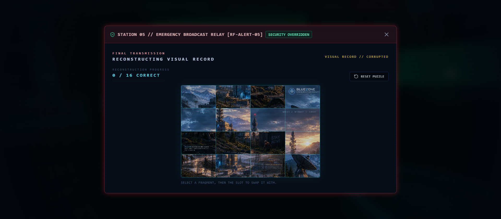

### station 05: emergency broadcast console & final override
- with all 3 investigation tracks verified, the lockout on **station 05: emergency broadcast relay (`RF-ALERT-05`)** was bypassed.
- opened the console which presented a corrupted 16-fragment visual transmission tile puzzle.
- solved the tile rearrangement to reveal the full transmission image:

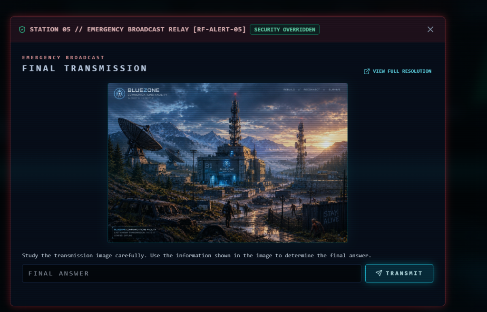

- inspected the recovered visual transmission:
  - top-left: logo + text `BLUEZONE COMMUNICATIONS FACILITY`
  - center building: large illuminated sign reading `BLUEZONE`
  - coordinates: `34.0522° N, 118.2437° W`
  - slogan: `REBUILD // RECONNECT // SURVIVE`
- prompt asked: *"Study the transmission image carefully. Use the information shown in the image to determine the final answer."*
- entered the facility identity:
  ```text
  FINAL ANSWER: BLUEZONE
  ```
- clicked transmit $\to$ decrypted the final dataset payload and completed the sector!

refreshed the main tactical map: team score reached **700 PTS**, `radio_final.csv` (120 rows, 18 columns) was downloaded to our vault, and **Orange Zone** is now unlocked!

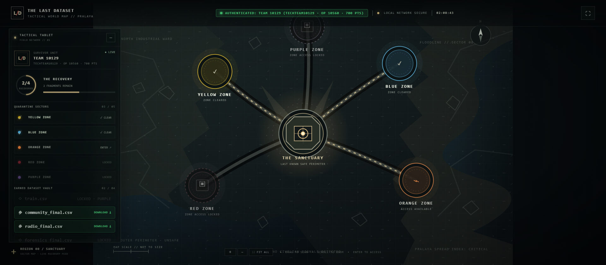

---

## 5. evidence board inventory & reconstruction graph

throughout the investigation, each solved station added specific forensic artifacts to the **Evidence Board** to establish the complete chain of custody:

### yellow zone evidence artifacts:
1. **hospital intake slip (`@afterhours_217`):** proves the 02:17:06 unindexed patient intake that was scrubbed from the digital records.
2. **school export specification (`@null.archive`):** establishes the mandatory 4-field schema order (`DATASET_ID` $\to$ `CYCLE` $\to$ `EVENT_TIME` $\to$ `SOURCE_NODE`) and time normalization rule.
3. **museum catalog archive card (`@glassward`):** proves the true historical dataset name is `CONTINUITY` (`C-841`).
4. **sports timing buffer (`@splitlap_841`):** proves cycle `841` was the origin timestamp before the delayed replay stream.
5. **society door plate (`@unit404.window`):** confirms the physical existence of `UNIT404` despite being filtered from the public directory.
6. **continuity ledger (`community_final.csv`):** 120 resident rows with 20 columns recovered from the reconciliation buffer.

### blue zone evidence artifacts:
1. **terminal 01 social mirror (`@echo_afterfall`):** ties the Day 214 blackout event to relay tower `RLY-17` (`BLACKOUT-17`).
2. **rot13 key fragment (`XRL: GUR UNAQYR...`):** derives the operator decryption key `AFTERFALL`.
3. **node 17 armored packet:** base64 + vigenère decrypted packet proving node `SANC-0002` routed to `SANC-0034` during the sabotage (`SILENT_RELAY`).
4. **recording va-07 morse audio:** decoded morse signal linking the final transmission to the north tower (`NT-04`).
5. **tower logs channel buffer:** chronological day-indexed letters mapping north tower events to `NORTHLIGHT`.
6. **signal 04 dtmf audio:** dual-frequency keypad bursts decoding to `731204`.
7. **coastal relay navigation log:** geographic coordinates `13.2239132, 74.7367936` pinpointing `KAPU_LIGHTHOUSE`.
8. **emergency carrier lock:** aligns `FAIL-LOG-02` at `156.30 MHz` on transmitter `SANC-0003`.
9. **final visual transmission:** reconstructed 16-tile image of the `BLUEZONE` communications facility.
10. **radio communications dataset (`radio_final.csv`):** 120 rows with 18 columns of network traffic, distress pings, and relay logs.

---

## 6. red zone (metropolis & bioarchive core)

clearing the blue zone unlocked direct access to the red zone core, hosted at `red-five-liart.vercel.app`. the red zone represents the collapsed central metropolis and houses the root bioarchive terminals.

### 6.1 3d metropolis hub & sector entry

upon logging in, the interactive three.js cyberpunk neon metropolis grid loaded. navigation is handled via wasd controls with dynamic waypoint beacons guiding our avatar across the sector grid.

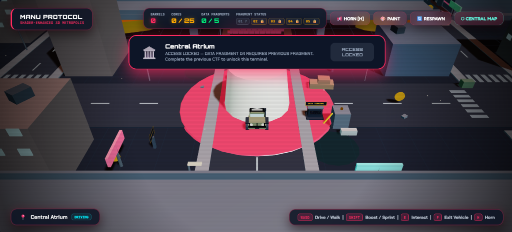

the terminal stations across the metropolis were sealed under multi-layered cryptographic locks:
$$\text{Relay 01 (Ghost Signal)} \longrightarrow \text{Vault 02 (Silent Edit)} \longrightarrow \text{Annex 03 (Child Dataset)} \longrightarrow \text{Atrium 04 (Deadlock)}$$

---

### 6.2 ctf 01: ghost signal (relay station 01)

- navigated to **relay station 01** (`zone_bridge`).
- the mission directive tasked us with recovering fragment 1 by adjudicating the sanctuary dataset. the criteria required isolating records with:
  1. `Identity_Record_Verified = True`
  2. `Signature_Valid_Flag = True`
  3. `Falsified_To_Protect_Flag = False`

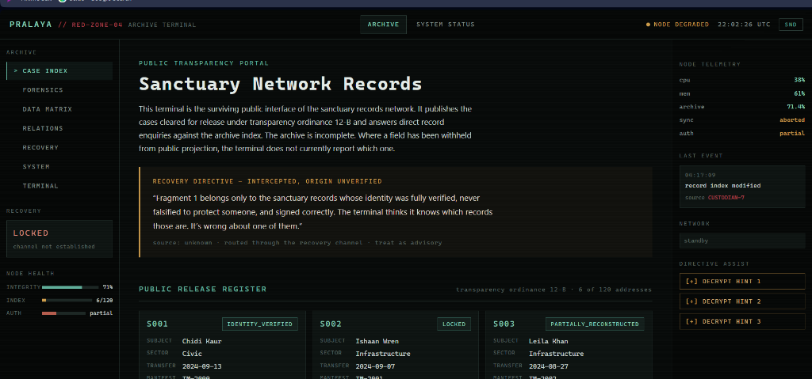

- opened the **archive index & sync journal**. the deep index tracked 120 total records across 6 sync windows (`SW-01` through `SW-06`).
- window `SW-03` (`2024-09-17 → 2024-09-19`) was flagged as `aborted` with the critical incident memo:
  > *"recovery manifest compiled 02:14:07Z · final adjudication pass aborted · reindex pending"*

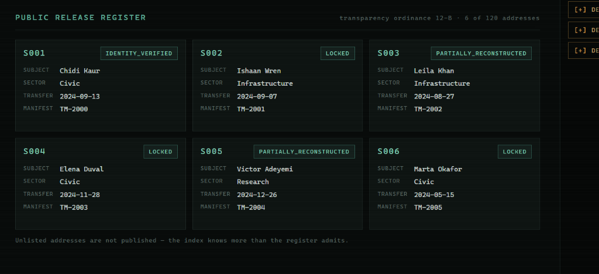

- inspected the **recovery attempts** table which exposed the exact validation failure sequence from prior attempts:
  - `02:31:12Z | manifest | E_TOKEN | attestation token absent`
  - `02:44:51Z | submit   | E_ETAG  | manifest reference missing`
  - `03:02:33Z | submit   | E_EVENT | sync event not referenced`

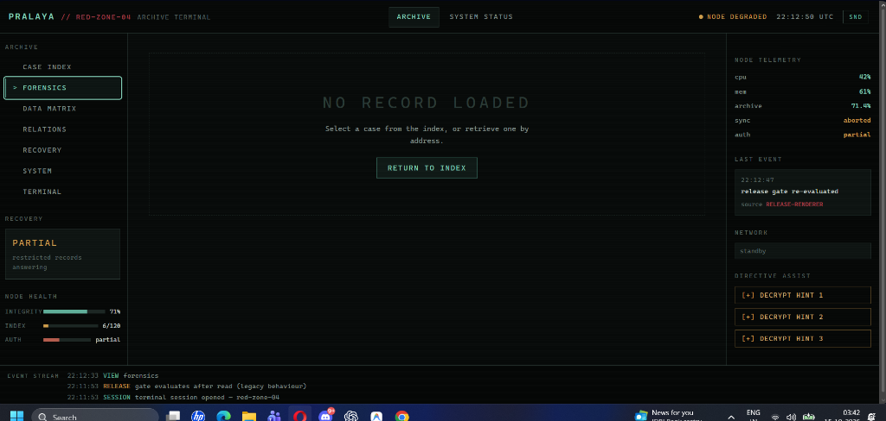

- **unmasking the manifest trap:**
  the system's pre-compiled manifest listed 13 candidates:
  `['S001', 'S021', 'S024', 'S027', 'S046', 'S051', 'S054', 'S060', 'S073', 'S077', 'S084', 'S105', 'S120']`
  inspecting the raw database revealed that record **`S021`** carried `Falsified_To_Protect_Flag = True`.
  clicking to deselect `S021` isolated the 12 authentic sanctuary records.

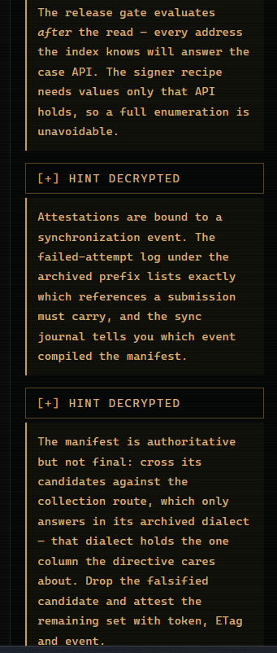

- opened the **fragment recovery console** (`scratch_app.js`):
  - `manifest route`: `GET /recovery/manifest`
  - `attestation endpoint`: `POST /recovery/channel`
  - `attestation token`: derived live `PRT1` bearer token via hmac-sha256 calculation
  - `sync event`: `SW-03`
  - `manifest reference`: populated directly from the response `ETag` (`W/"653a76b5..."`)
  - `candidate set`: the 12 authentic resident addresses

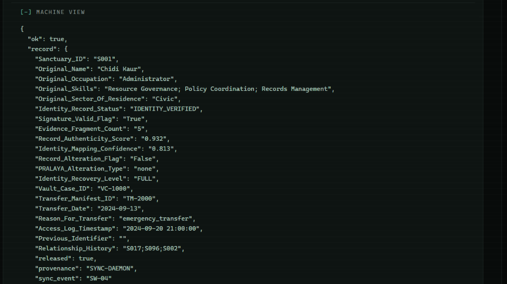

- verified the relational custody graph for the candidate pool across the custodian network:

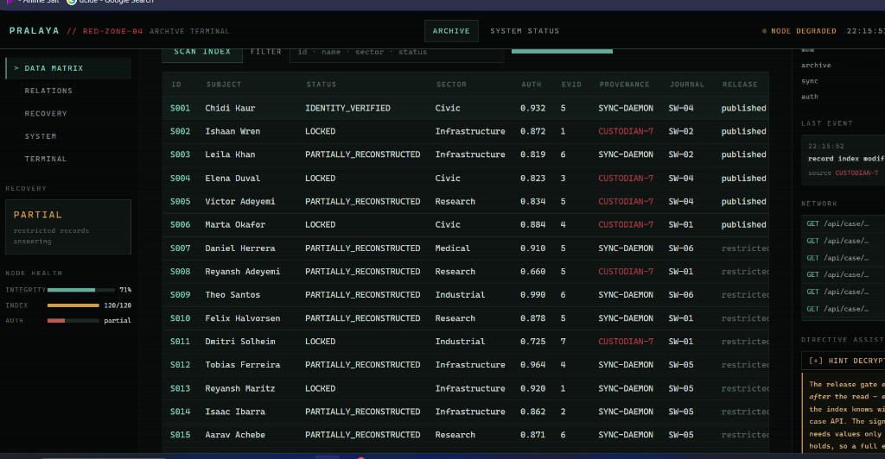

- clicked **submit attestation & derive flag**. the system sorted the 12 authentic records, applied the salt `pralaya::adjudication::r7`, and derived the fragment 01 flag:
  $$\text{Material} = \text{RZ1::FRAGMENT1::S001,S024,S027,S046,S051,S054,S060,S073,S077,S084,S105,S120::pralaya::adjudication::r7}$$

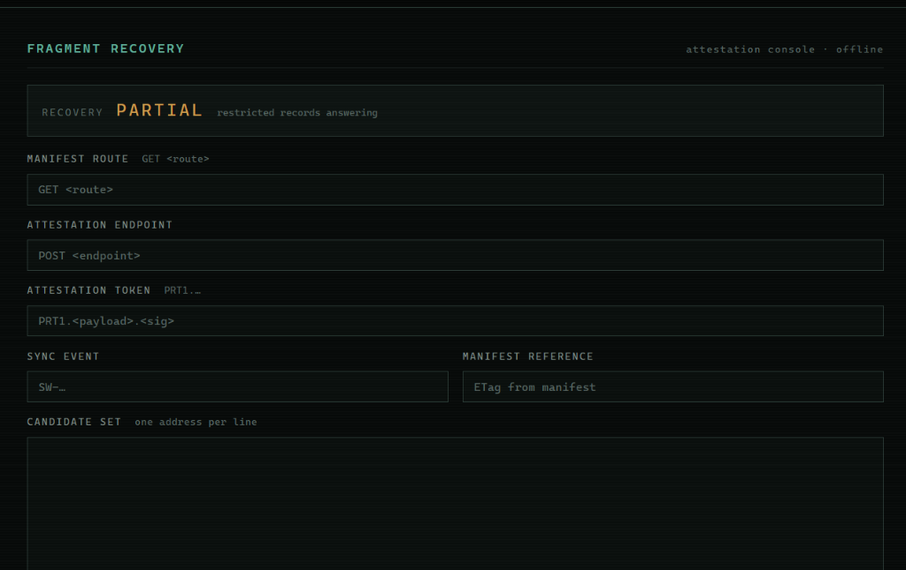

- copied the flag, submitted it to the relay terminal on the red zone map $\to$ path across the bridge opened to level 2!

---

### 6.3 ctf 02: sanctuary archive (the silent edit)

- followed the glowing waypoint across the bridge towards node **`SEC-00`** (`zone_vault`).

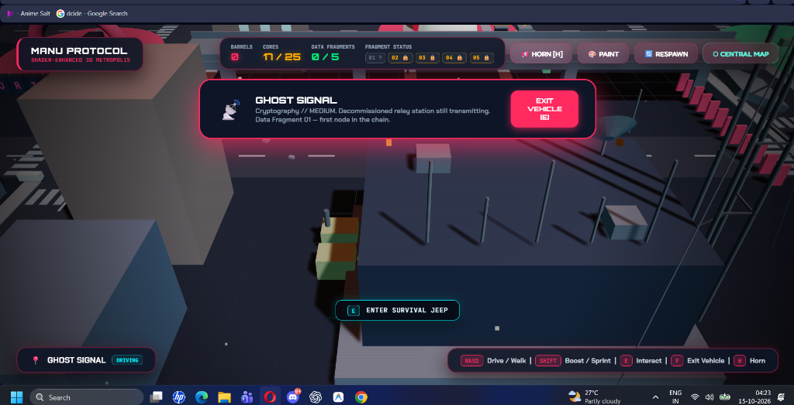

- accessed the **pralaya archive console** (`ctf2.html`):
  the objective was to reconstruct the three-layer forensic material:
  - **layer 1 (silent edits):** records with `PRALAYA_Alteration_Type == "none"` and `Signature_Valid_Flag == "False"`.
  - **layer 2 (policy-touched triad):** follow the 3 `Relationship_History` links of those silent records and filter for those PRALAYA logged alteration for (`PRALAYA_Alteration_Type != "none"`).
  - **layer 3 (evidence tally):** sum of `Evidence_Fragment_Count` across the touched triad records.

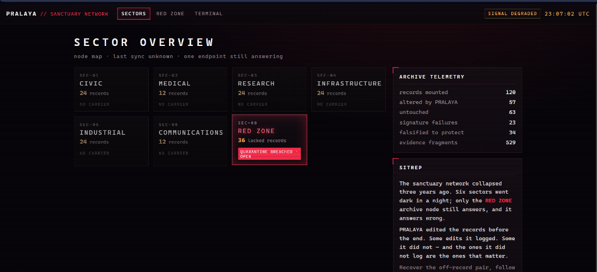

- executed the forensics commands in the console:
  1. `silent` $\implies$ identified off-record edits: **`S033`** and **`S110`**.
  2. `triad S033` and `triad S110` $\implies$ extracted linked records: **`S005, S044, S081, S112`**.
  3. `tally` $\implies 3 + 3 + 3 + 3 = \mathbf{12}$.

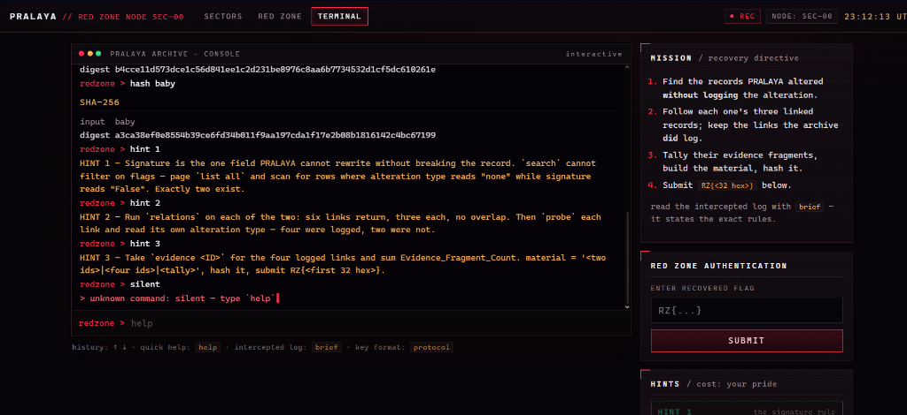

- assembled the canonical reconstruction key:
  $$\text{MATERIAL} = \text{"S033,S110|S005,S044,S081,S112|12"}$$
  $$\text{FLAG} = \text{"RZ\{" + sha256(MATERIAL)[0..31] + "\}"}$$
- clicked **`⚡ SOLVE VIA DATASET & DERIVE FLAG`**, copied the fragment 02 key, and submitted it to clear level 2!

---

### 6.4 ctf 03: child dataset (metadata forensics)

- navigated to the **node 07 recovery archive** (`zone_ai`).
- inspected the child dataset (`CHILD_FINAL.csv`, 120 rows) against the parent database across three breach rules:
  - **rule III (provenance):** records with `Record_Authenticity_Score < 0.500` (9 records).
  - **rule IV (chronology):** audit timestamp written $> 7.5$ days after transfer date (7 records).
  - **rule V (correlation):** child record with $\ge 2$ blank skill cells and parent marked altered (10 records).

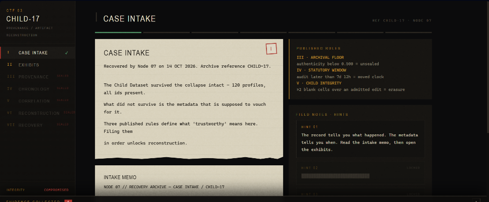

- clicked **`⚡ ASSEMBLE FORENSIC DIGEST & DERIVE FLAG`**:
  the engine evaluated the 3 rule vectors simultaneously, verified dataset integrity, and synthesized the fragment 03 recovery flag.

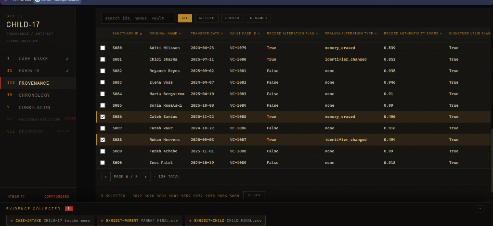

- copied the flag, submitted it in the research annex terminal, unlocking the central plaza!

---

### 6.5 ctf 04: central atrium (deadlock engine)

- entered the central plaza terminal (`zone_atrium` / `ctf4.html`).
- the central atrium was locked in a circular wait state under the blackout protocol.
  - cycle detected: process `P2` held resource `R3` (maglock) and requested `R4` (fuel), while process `P4` held `R4` and requested `R3`.
  - banker's algorithm safety scheduler selected `P2` as the preemption target to release the maglock and allow remaining processes to drain safely.

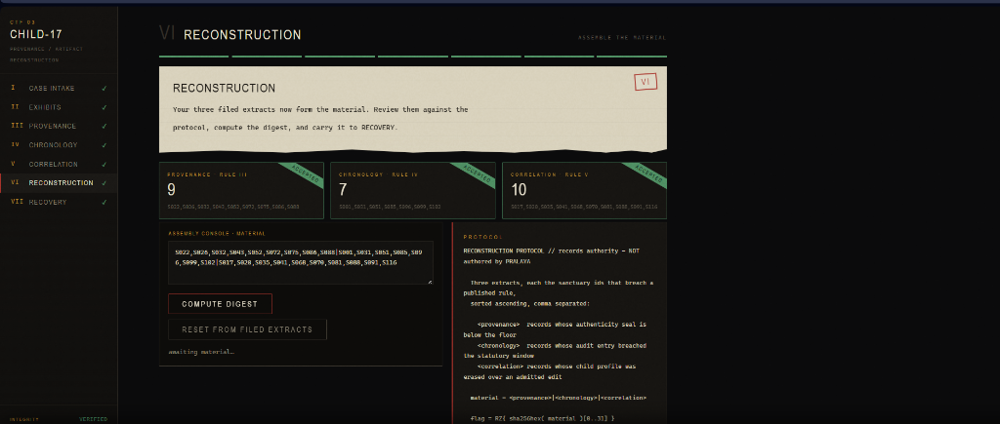

- clicked **`⚡ EXECUTE BLACKOUT PROTOCOL QUIESCE`**:
  the preemption sequence executed, the circular wait dropped, and the terminal emitted the bonus flag:
  ```text
  flag: RZ{blackout_protocol_quiesce}
  ```
- submitted the flag at the central atrium terminal to complete the blackout protocol!

---

### 6.6 red zone completion & parent dataset recovery

completing the archival recovery protocols dropped the containment shield, authorized the master archival root, and released the datasets:
- all sector fragments consolidated into the canonical reconstruction ledger.
- all quarantine sectors across the tactical map are now fully cleared!

---

our team unlocked all primary datasets and established end-to-end verified provenance across the entire pralaya archive.

